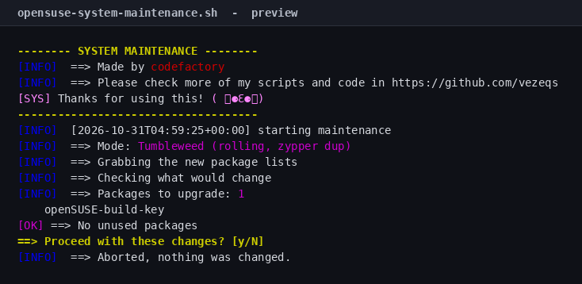
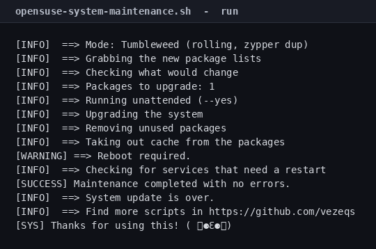

# openSUSE System Maintenance Script

[](LICENSE)
[](#tested-on)

One command to update, clean and repair openSUSE Leap or Tumbleweed. It shows
you what will change, **asks before touching anything**, and tells you if a
reboot or a service restart is needed.



## Quick start

```bash
git clone https://github.com/vezeqs/opensuse-system-maintenance.git
cd opensuse-system-maintenance
sudo ./opensuse-system-maintenance.sh
```

## What it does

| # | Step | Command |
|---|------|---------|
| 1 | Refresh repositories (3 attempts) | `zypper refresh` |
| 2 | Show what would change | `zypper list-updates`, `zypper packages --unneeded` |
| 3 | **Ask for confirmation** | `Proceed? [y/N]` |
| 4 | Verify (and repair) installed dependencies | `zypper verify` |
| 5 | Upgrade everything | `zypper dup --allow-vendor-change` (Tumbleweed) or `zypper update` (Leap) |
| 6 | Remove unused packages and their deps | `zypper remove --clean-deps` |
| 7 | Clean the package cache | `zypper clean --all` |
| 8 | Check for a pending reboot | `zypper needs-rebooting` |
| 9 | Check for stale processes | `zypper ps -s` |

## Tumbleweed vs Leap

The script reads `/etc/os-release` and picks the right upgrade command:

- **Tumbleweed** is a rolling release, so it uses `zypper dup`. `--allow-vendor-change`
  is included because Packman and other third-party repos routinely switch
  packages between vendors.
- **Leap** is a fixed release, so it uses `zypper update`.

`zypper ps -s` is a read-only check that lists processes still using files that
were deleted by the upgrade. Those are the services you want to restart before
the next reboot.

## The confirmation prompt

Nothing is installed, removed or upgraded until you answer `y`. Before asking,
the script prints how many packages would be upgraded, the first ten of them,
and any unused packages that would be removed:


Answer anything but `y` and it exits with `nothing was changed`.

## Options

| Flag | Effect |
|------|--------|
| `-y`, `--yes` | Skip the confirmation prompt (cron, unattended runs) |
| `-n`, `--dry-run` | Print every command without running it |
| `-h`, `--help` | Show usage |

Without `-y`, the script refuses to run if there is no terminal to confirm on,
so a cron job fails loudly instead of upgrading silently.

## Example

A real run against an `opensuse/tumbleweed` container:



## Requirements

- openSUSE Leap 15.5+ or Tumbleweed
- root (`sudo`)
- Bash 4.0+ (default everywhere)

## Safety notes

- **`zypper dup --allow-vendor-change` can switch packages between repositories.**
  That is expected on Tumbleweed with Packman, but it is a real change and the
  preview shows what will be upgraded first.
- **`zypper remove --clean-deps` removes dependencies** that nothing needs any
  more, not just the named package.
- **`zypper clean --all` deletes cached packages**, so a rollback needs a
  re-download.
- **`--dry-run` never changes anything**, including the preview queries.
- **Fails fast.** `set -euo pipefail` plus an `ERR` trap that reports the failing
  command and its exit status.

## Tested on

| Image | Result |
|-------|--------|
| `opensuse/tumbleweed` 20261028 | Upgrade, unused-package removal, cache clean, reboot check and stale-process check all completed |
| `opensuse/leap:15.6` | Leap branch: `zypper update`, reboot check, stale-process check |

`zypper needs-rebooting` returned 0 (no reboot) in the container. The script
maps zypper's exit code 102 to "Reboot required" and any other non-zero code to
an explicit "could not determine" warning, so a broken check is never reported
as a clean result.

## Verify it yourself

```bash
make check
```

`make check` runs `bash -n`, shellcheck when installed, the smoke tests, the
reboot-exit-code and table-parser regression tests and the asset check. The
screenshots come from a real `opensuse/tumbleweed` container:

`tests/assets.sh` also verifies `assets/source.sha256`: if the script changes without regenerating the screenshots, `make check` fails.

```bash
podman run --rm -v "$PWD:/repo:ro,Z" opensuse/tumbleweed \
  bash /repo/opensuse-system-maintenance.sh --dry-run
```

`make container-test` runs the preview-failure test (needs podman).

## Limits

- It does not roll back; use Snapper for that.
- It does not upgrade Leap from one release to the next.
- It does not pin vendors or manage third-party repositories.
- Tumbleweed and Leap 15.6 were both run. The Leap container was up to date, so
  its update was a no-op.

## License

MIT — see [LICENSE](LICENSE).

## Author

**codefactory** — [github.com/vezeqs](https://github.com/vezeqs)
